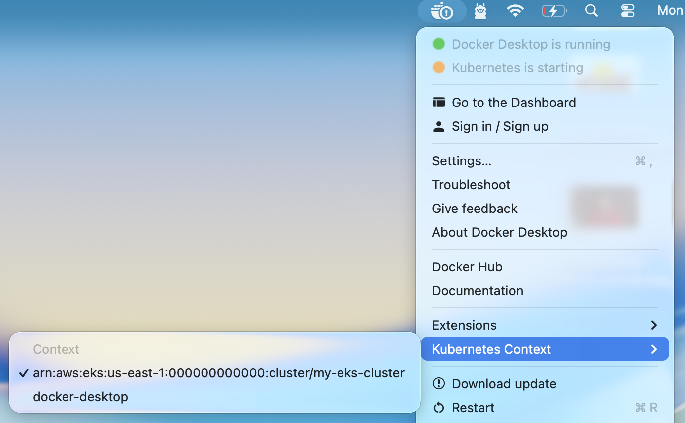

## For local development
We are not using .env file in project so all process.env should pass while it running, in docker and kubernates its handled by their config files, but when you run it without docker using npm run dev we need to pass them, so just update dev script of package.json in all services
**Auth**
```
"dev": "MONGO_URI=mongodb://localhost:27017/ticketing JWT_KEY=sknew ts-node-dev --respawn --transpile-only src/index.ts",
```
**expiration**
```
"dev": "NATS_URL=http://localhost:4222 NATS_CLUSTER_ID=test-cluster NATS_CLIENT_ID=test-client-expiration ts-node-dev --respawn --transpile-only src/index.ts",
```
**orders**
```
"dev": "NATS_URL=http://localhost:4222 NATS_CLUSTER_ID=test-cluster NATS_CLIENT_ID=test-client-order MONGO_URI=mongodb://localhost:27017/mic_orders JWT_KEY=sknew ts-node-dev --respawn --transpile-only src/index.ts",
```
**payments**
```
"dev": "STRIPE_KEY=stripekeyhere NATS_URL=http://localhost:4222 NATS_CLUSTER_ID=test-cluster NATS_CLIENT_ID=test-client-payments MONGO_URI=mongodb://localhost:27017/mic_payments JWT_KEY=sknew ts-node-dev --respawn --transpile-only src/index.ts",
```
**tickets**
```
"dev": "NATS_URL=http://localhost:4222 NATS_CLUSTER_ID=test-cluster NATS_CLIENT_ID=test-client-ticket MONGO_URI=mongodb://localhost:27017/mic_ticket JWT_KEY=sknew ts-node-dev --respawn --transpile-only src/index.ts",
```
**client**
```
"dev": "VITE_AUTH_API_URL: http://localhost:3000 VITE_TICKET_API_URL: http://localhost:3001 VITE_PAYMENT_API_URL: http://localhost:3002 VITE_ORDER_API_URL: http://localhost:3003 vite",

```

## For local development using Docker
```
cd infra/compose 
docker compose up -d
```
Now you can see website running on port 5178
```
http://localhost:5178/
```

## Kubernates
### First see some kubernates commands
<span style="color:blue">Get List of clusters exists or configured in your pc</span>
```
kubectl config get-contexts
```
**Output**
```
CURRENT   NAME                                                          CLUSTER                                                     NAMESPACE
*         arn:aws:eks:us-east-1:000000000000:cluster/my-eks-cluster     same as name                                                same as name  
          docker-desktop                                                docker-desktop                                              docker-desktop    
```

> [!NOTE]
> I used "same as name" to fit above output in md file otherwise it was same arn:aws:eks:us-east-1:000000000000:cluster/my-eks-cluster 
> You can see its showing CURRENT * for my-eks-cluster which i created using floci local emulator.

<span style="color:blue">We can also use below command to see current context instead of get all list</span>
```
kubectl config current-context
```
**Output**
```
arn:aws:eks:us-east-1:000000000000:cluster/my-eks-cluster
```

<span style="color:blue">Get cluster information</span>
```
kubectl cluster-info
```

<span style="color:blue">Then check which API server URL your active context uses:</span>
```
kubectl config view --minify
```

Look for a line similar to:
```
clusters:
- cluster:
    server: https://localhost:6500
```

<span style="color:blue">For this project, I am using docker desktop, so switch on it:</span>
```
kubectl config use-context docker-desktop
```

<span style="color:blue">We can also switch context using docker ui</span>


**In this project we are using a secret**

<span style="color:blue">make sure you have created jwt and stripe secret otherwise you will get CreateContainerConfigError</span>
```
kubectl get secrets
```
<span style="color:blue">If output is empty or don't contain "jwt-secret or stripe-secret", Create it using below command</span>
```
kubectl create secret generic jwt-secret --from-literal=JWT_KEY=my_super_secret_key
kubectl create secret generic stripe-secret --from-literal=STRIPE_KEY=placeyourstripekeyhere
```

<span style="color:blue">Make sure you have created docker images for all services, just cd in service directory and run below command for each service</span>
```
docker build -f Dockerfile_prod -t auth-app:1.2 .
docker build -f Dockerfile_prod -t expiration-app:1.2 .
docker build -f Dockerfile_prod -t orders-app:1.2 .
docker build -f Dockerfile_prod -t payments-app:1.2 .
docker build -f Dockerfile_prod -t tickets-app:1.2 .
docker build -t client-app:1.2 .
```

> [!NOTE]
> here i have used -f for pass dockerfile name because i have two dockerfiles, Dockerfile for dev and Dockerfile_prod for production, if use Dockerfile then no need to pass -f as you can see not used in client-app build

Now in infra k8s folder we have created `deployment` and `service` for all, also used 3000 port for all backend services and port 5173 for frontend.
Now as all running in same 3000 port so how it will work ?

We have created a ingress controller service `ingress-srv.yaml` which will forward request to required service according to configuration

in this we have set a host `ticketing.test`, So we need to do following steps for ingress controller.
#### 1. Make sure ingress contoller installed
```
kubectl get pods -n ingress-nginx
```
**If Output empty, Install it**

#### 2. This installs the official Kubernetes NGINX Ingress Controller.
```
kubectl apply -f https://raw.githubusercontent.com/kubernetes/ingress-nginx/main/deploy/static/provider/cloud/deploy.yaml
```
#### 3. Add host file entry as below
```
nano /etc/hosts
127.0.0.1 	ticketing.test
```
<span style="color:blue">Now for start all pods and service, run below command</span>
```
cd infra/k8s
kubectl apply -f .
```

**Output**
```
service/auth-srv created
deployment.apps/auth-mongo-depl created
service/auth-mongo-srv created
deployment.apps/client-depl created
service/client-srv created
deployment.apps/expiration-depl created
deployment.apps/expiration-redis-depl created
service/expiration-redis-srv created
ingress.networking.k8s.io/ingress-service created
deployment.apps/nats-depl created
service/nats-srv created
deployment.apps/orders-depl created
service/orders-srv created
deployment.apps/orders-mongo-depl created
service/orders-mongo-srv created
deployment.apps/payments-depl created
service/payments-srv created
deployment.apps/payments-mongo-depl created
service/payments-mongo-srv created
deployment.apps/tickets-depl created
service/tickets-srv created
deployment.apps/tickets-mongo-depl created
service/tickets-mongo-srv created
```

<span style="color:blue">Now you can run get pods command to see pod running status</span>
```
kubectl get pods
```
**Output**
```
NAME                                     READY   STATUS              RESTARTS   AGE
auth-depl-7f89d6fd6d-k5gjz               0/1     ContainerCreating   0          55s
auth-mongo-depl-86c688d6f8-5sp8t         0/1     ContainerCreating   0          55s
client-depl-79ddbdcf84-hhzkr             1/1     Running             0          55s
expiration-depl-6f6547d58f-zw6pr         0/1     ContainerCreating   0          55s
expiration-redis-depl-56c5cd8cf6-thgvf   0/1     ContainerCreating   0          55s
nats-depl-6468fdb94d-xfgpd               0/1     ContainerCreating   0          55s
orders-depl-66f9457487-8bkrz             0/1     ContainerCreating   0          54s
orders-mongo-depl-694c9884b8-nj9fr       0/1     ContainerCreating   0          54s
payments-depl-69fc96cf54-khf6z           0/1     ContainerCreating   0          54s
payments-mongo-depl-b658ddb68-2lrfw      0/1     ContainerCreating   0          54s
tickets-depl-9d7c8744c-kk8fd             0/1     ContainerCreating   0          54s
tickets-mongo-depl-7475b88bfd-xv4rc      0/1     ContainerCreating   0          53s
```

**Run same command after few minutes**
```
NAME                                     READY   STATUS    RESTARTS   AGE
auth-depl-7f89d6fd6d-k5gjz               1/1     Running   0          2m51s
auth-mongo-depl-86c688d6f8-5sp8t         1/1     Running   0          2m51s
client-depl-79ddbdcf84-hhzkr             1/1     Running   0          2m51s
expiration-depl-6f6547d58f-zw6pr         1/1     Running   0          2m51s
expiration-redis-depl-56c5cd8cf6-thgvf   1/1     Running   0          2m51s
nats-depl-6468fdb94d-xfgpd               1/1     Running   0          2m51s
orders-depl-66f9457487-8bkrz             1/1     Running   0          2m50s
orders-mongo-depl-694c9884b8-nj9fr       1/1     Running   0          2m50s
payments-depl-69fc96cf54-khf6z           1/1     Running   0          2m50s
payments-mongo-depl-b658ddb68-2lrfw      1/1     Running   0          2m50s
tickets-depl-9d7c8744c-kk8fd             1/1     Running   0          2m50s
tickets-mongo-depl-7475b88bfd-xv4rc      1/1     Running   0          2m49s
```
Now you can see all pods running if there is any issue it will show in status

<span style="color:blue">Now you can run get svc command to see all running services</span>
```
kubectl get svc
```
**Output**
```
NAME                   TYPE        CLUSTER-IP       EXTERNAL-IP   PORT(S)             AGE
auth-mongo-srv         ClusterIP   10.109.94.145    <none>        27017/TCP           4m38s
auth-srv               ClusterIP   10.96.94.153     <none>        3000/TCP            4m38s
client-srv             ClusterIP   10.109.253.18    <none>        5173/TCP            4m38s
expiration-redis-srv   ClusterIP   10.103.60.180    <none>        6379/TCP            4m38s
kubernetes             ClusterIP   10.96.0.1        <none>        443/TCP             3h1m
nats-srv               ClusterIP   10.100.220.140   <none>        4222/TCP,8222/TCP   4m38s
orders-mongo-srv       ClusterIP   10.97.72.2       <none>        27017/TCP           4m37s
orders-srv             ClusterIP   10.111.193.47    <none>        3000/TCP            4m38s
payments-mongo-srv     ClusterIP   10.99.179.23     <none>        27017/TCP           4m37s
payments-srv           ClusterIP   10.100.164.191   <none>        3000/TCP            4m37s
tickets-mongo-srv      ClusterIP   10.97.150.13     <none>        27017/TCP           4m37s
tickets-srv            ClusterIP   10.97.57.194     <none>        3000/TCP            4m37s
```

Now open virtual host url in browser and see
```
http://ticketing.test
```


<span style="color:blue">Once all work done and you want to free space from cluster or remove pods, run below command</span>
```
kubectl delete -f .
```
Above command will stop and remove all container and free space

<span style="color:blue">start a pod (similar to run a docker image)</span>
kubectl apply -f auth-depl.yaml

<span style="color:blue">Access above port in host browser</span>
```
kubectl port-forward service/auth-srv 3000:3000
```

<span style="color:blue">This deletes all resources belonging to the built-in all resource category across all namespaces.</span>
```
kubectl delete all --all --all-namespaces
```

<span style="color:blue">Open sh for selected pod simlar to docker exec</span>
```
kubectl exec -it auth-depl-77b894578b-nc5bx -- sh
```


<span style="color:blue">If you want pods to re start just delete pod</span>
```
kubectl delete pod <pod_name>
```
<span style="color:blue">if you want to create new pod if you have changed something in docker image then</span>
```
kubectl apply -f <depl_file_name>
```

> [!NOTE]
> if you changed something in code and re build image then you need to update tag otherwise kubectl apply will not use new image and nothing change


1️⃣ If you updated the Docker image tag

If you rebuilt your Docker image (for example: client-app:1.1):

Update your deployment YAML to use the new image:

containers:
  - name: client
    image: client-app:1.1


Apply the deployment:

kubectl apply -f client-depl.yaml


Kubernetes will automatically create a new pod with the updated image and terminate the old one.

2️⃣ If you kept the same image tag (e.g., client-app:1.0)

Kubernetes caches the image by default. You need to force it to pull the updated image.

Option 1: Change imagePullPolicy to Always in your deployment:

imagePullPolicy: Always


Then apply:

kubectl apply -f client-depl.yaml


Option 2: Delete the existing pod — Kubernetes will recreate it automatically:

kubectl delete pod <client-pod-name>


### Some Known issues
#### 1. Port 80 used by apache (in this case http://ticketing.test will point to apache localhost port 80 and not show your website)

<span style="color:blue">Make sure port 80 not used by other like apache</span>
```
sudo lsof -i :80
Or
sudo ss -ltnp | grep ':80'
```
If the output shows apache2 or httpd, Apache is handling requests on port 80.

<span style="color:blue">Check how your Ingress Controller is exposed</span>
```
kubectl get ingress
kubectl get pods -A | grep -i ingress
kubectl get svc -A | grep -i ingress
```

You need to determine whether your NGINX Ingress Controller is accessible through localhost:80, a NodePort, or another port.

> [!NOTE]
> If port 80 is used by apache, you can fix it by two approach

##### Option A: Let NGINX Ingress use port 80
In this case you need to stop Apache
```
sudo systemctl stop apache2
sudo systemctl disable apache2
```
##### Option B: Keep Apache running and use 8080 for ingress
Port-forward service on different port, so in kubernates its on port 80 but outside it will be available on port 8080
```
kubectl port-forward -n ingress-nginx svc/ingress-nginx-controller 8080:80
```
Now you can open website using
```
http://ticketing.test:8080/
```

#### 2. ticket pod and ticket mongodb pod both working, but ticket container facing conneciton problem

This can be happen when ticket pod started before mongodb pod get started, just recreate ticket pod, there is different ways for doing this

* delete pod using k8s config file
```
kubectl delete -f tickets-depl.yaml
kubectl apply -f tickets-depl.yaml
```
As we deleted pod using k8s config file, we need to create it our self

* delete pod by pod name
First run below commnd to get ticket pod name 
```
kubectl get pods
```
Run below command for delete pod
```
kubectl delete pod tickets-depl-9d7c8744c-fhh57
```
Now we don't need to create pod ourself kubernetes will automatic create ticket pod because in deployment config we set 1 replica, so control panel will check and found no ticket pod running, so it will automatic get started.


#### 3. if you have used secretKeyRef in your yaml file but not create secret using kubecrl then pod running status will show CreateContainerConfigError

```
kubectl create secret generic jwt-secret --from-literal=JWT_KEY=my_super_secret_key
kubectl create secret generic stripe-secret --from-literal=STRIPE_KEY=sk_test_h...
```

#### 4.  If you get some connection error between services like below, its means coredns not working proper in cluster
```
MongooseServerSelectionError: getaddrinfo EAI_AGAIN auth-mongo-srv at \_handleConnectionErrors
```
**Possible reason**
Your Docker Desktop Kubernetes cluster is broken or incomplete.

CoreDNS was not deployed (or got removed).

#### Fix (Docker Desktop)

Do this exactly:

1️⃣ Disable Kubernetes

Docker Desktop → Settings → Kubernetes
Uncheck Enable Kubernetes
Click Apply & Restart

2️⃣ Re-enable Kubernetes

Enable it again
Click Apply & Restart

Wait until it says:

Kubernetes is running

3️⃣ Verify CoreDNS Is Back

Run:

kubectl get pods -n kube-system

Now you should see:

coredns-xxxxx Running

4️⃣ Redeploy Your App
kubectl delete -f .
kubectl apply -f .

Then test inside pod:

kubectl exec -it <auth-pod> -- nslookup auth-mongo-srv

It should now resolve to a ClusterIP like:

10.x.x.x

🧠 Why This Happened

Sometimes Docker Desktop:

Fails to install DNS

Gets corrupted after sleep/restart

Loses CoreDNS during upgrade

It’s a known issue.

🚀 After Fix

Once CoreDNS is running:

Your existing connection string:

mongodb://auth-mongo-srv:27017/auth

Will work perfectly.

### Kubernetes Best Practices
- Always use a specific iamge tag or number otherwise latest use automatic you 
- Manage Liveness probe : Always set this otherwise you may face issue like pod is working but application inside is not working. so when we set Liveness probe kubenetes automatic restart pod if something wrong in application. In this we should just check a health url or a script without any dependencies
- Manage Readiness probe : Always set this otherwise kubenetes forward traffic before pod/application start and ready for accept traffic. In this we should check all dependencies working, like application connect with db, message broker, redis etc.
- Use Resources to limit and allow CPU and Memory for each pod.
- don't use NodePort service for access cluster outside like in browser, instead use LoadBalancer service or Ingress controller.
- Set at least 2 pod as replica, because if set 1 and pod restart then application will down until it start, so set replica at least 2, if you will not set replica in pod it will be default 1
- always use at least 2 worker node, if you have a small application but still use at least 2 worker node (aws ec2 instance), because if you run all pods in one worker node then if something went wrong with node, application will be doen.
- always use labels, so pods will be group and manage
- Use namespace, by default we have default namespace, so using this we can isolate resources, like ecommerce namaspace for all ecommerce application pods etc. We can also set access rights as per namaspace.

> [!NOTE]
> We have three options for check liveness, readiness 1. exec (execute a command script) 2. tcpSocket 3. httpGet (a url in applicaiton for just check)


